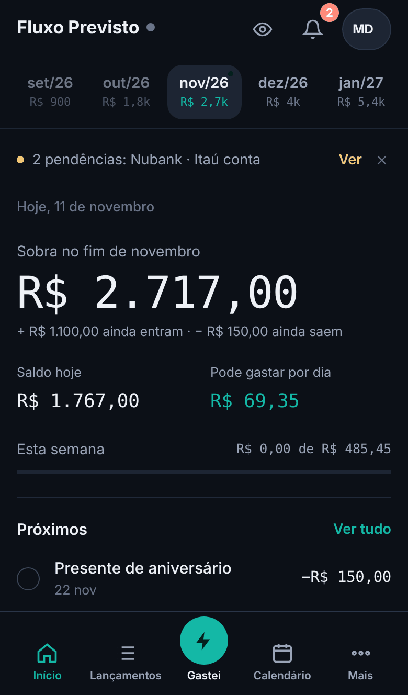
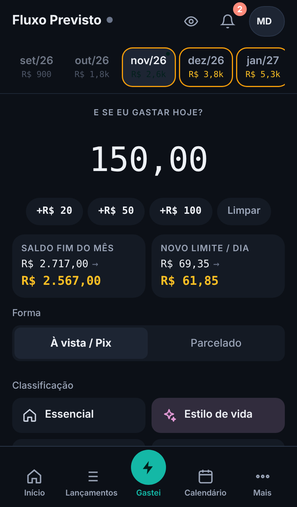
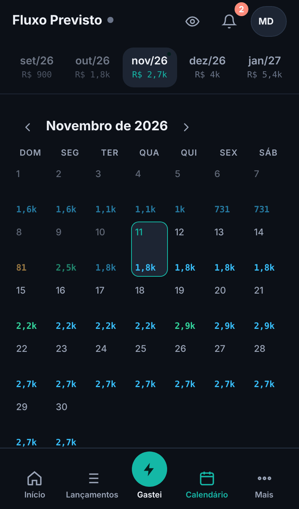
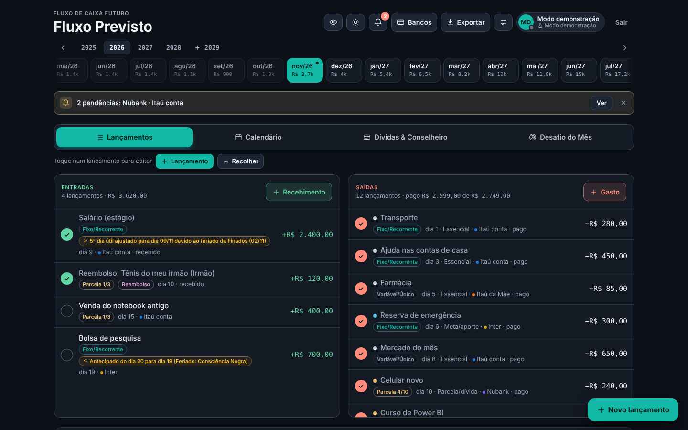
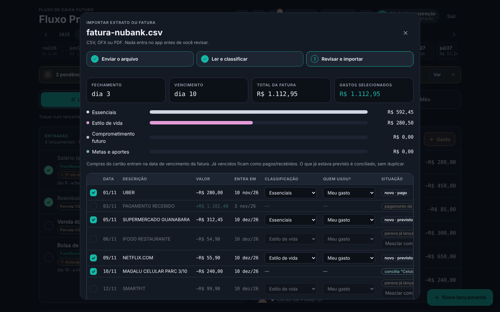

# Fluxo Previsto

**Saiba hoje quanto vai sobrar no fim do mês.** App web instalável (PWA) de previsibilidade financeira pessoal: projeta o saldo de cada dia e de cada mês, a partir de 2025 e sem data para acabar, com login, sincronização na nuvem e modo demonstração.

**App publicado:** [fluxo-previsto.netlify.app](https://fluxo-previsto.netlify.app) · entre em "Testar sem conta" para ver com dados de exemplo.

<p>
  
  
  
</p>



## O que o app faz

| Área | O que entrega |
| --- | --- |
| Projeção | Saldo de hoje, do fim do mês e de cada dia, em cascata mês a mês |
| Lançamentos | Únicos, recorrentes (com mudança de valor a partir de um mês) e parcelados; pago/recebido; edição rápida na lista |
| Dias úteis | 5º dia útil, último dia útil, antecipar ou adiar em feriados nacionais (e do RJ, opcional) |
| Método do Breno Nogueira | Quatro blocos: Essencial, Estilo de vida, Parcelas e dívidas, Metas e aportes, com metas 50/30/20 |
| Termômetro e simulador | "E se eu gastar hoje?" à vista ou parcelado, com prévia ao vivo nos meses e teto seguro por dia |
| Calendário | Saldo de cada dia, entradas e saídas |
| Dívidas | Cadastro, conselheiro e simulação de quitação |
| Desafio do mês | Meta de economia Leve, Ideal ou Hardcore, recalculada pela renda |
| Cartões de família | Gasto de outra pessoa no seu cartão vira reembolso previsto |
| Faturas e transferências | Fatura de cartão com baixa total ou parcial e saldo em aberto no mês seguinte; transferências entre contas próprias fora de entradas e saídas |
| Importação | CSV, OFX, PDF e prints em JPG ou PNG (lidos por IA), com conciliação e aviso de duplicidade |
| Open Finance | Sincronização pelo Meu Pluggy |
| Conforto | Tema claro e escuro, modo privacidade, 5 telas com gesto no celular, funciona offline |



## Tecnologias

HTML, CSS e JavaScript puro num único `index.html` (sem build) · Tailwind 3.4 · Supabase (Auth, Postgres com RLS, Realtime, Edge Functions em Deno) · jsPDF · Pluggy (Open Finance) · Google Gemini (leitura de PDF e prints) · Netlify · PWA com service worker.

## Documentação

| Documento | Conteúdo |
| --- | --- |
| [Arquitetura](docs/ARQUITETURA.md) | Diagrama e decisões |
| [Documentação técnica](docs/DOCUMENTACAO-TECNICA.md) | Módulos, motor de projeção, importação, testes |
| [Modelo de dados](docs/MODELO-DE-DADOS.md) | Tabela e formato do JSON |
| [Segurança e privacidade](docs/SEGURANCA.md) | RLS, segredos, LGPD |
| [Deploy e operação](docs/DEPLOY.md) | Como publicar e configurar |
| [Manual de uso](docs/MANUAL.md) | Como usar cada tela |
| [Histórico de versões](CHANGELOG.md) | O que mudou em cada versão |

## Rodar no computador

```bash
python -m http.server 8000
# abra http://localhost:8000 e entre em "Testar sem conta"
```

Para usar a nuvem com o seu próprio Supabase, siga [Deploy e operação](docs/DEPLOY.md).

## Estrutura

```
index.html              app inteiro (HTML + CSS + JS)
sw.js                   service worker (cache e offline)
manifest.webmanifest    app instalável
icons/                  ícones
supabase-schema.sql     tabela, RLS, gatilho e tempo real
supabase/functions/     open-finance e pdf-import (Deno)
privacidade.html        Política de Privacidade (LGPD)
termos.html             Termos de Uso
_headers, _redirects    segurança e rotas no Netlify
docs/                   documentação e imagens
```

## Autora

Jullia Patrocinio Rossi · [LinkedIn](https://www.linkedin.com/in/jullia-patrocinio) · [Portfólio](https://jullross.github.io/portf-lio)

Inspirado no método de planilha do Breno Nogueira e no visual do Prevy.
