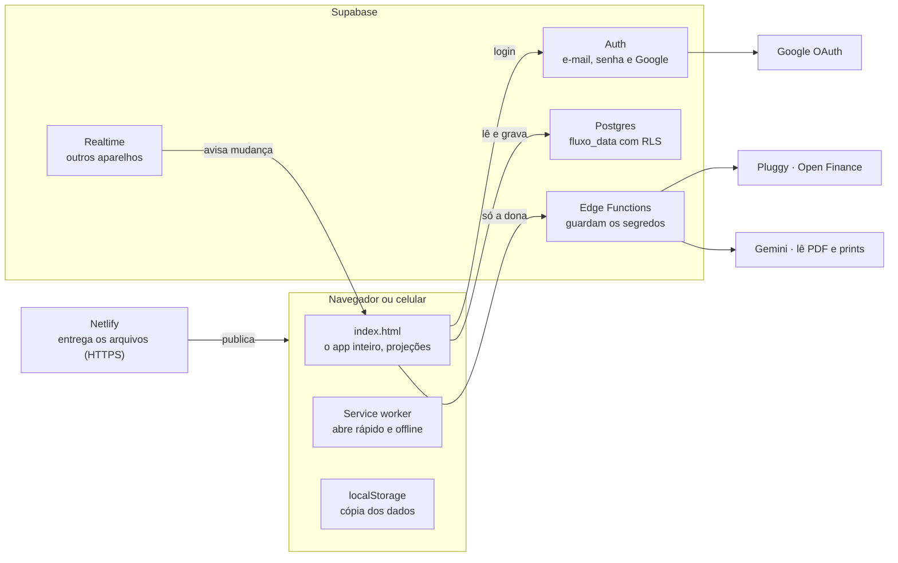

# Arquitetura

Todo o cálculo acontece no aparelho; o Supabase só guarda o JSON de cada pessoa e roda as duas funções que precisam de chave secreta.

O Netlify entrega os arquivos; o navegador faz login, lê e grava a linha da pessoa e recebe avisos de mudança de outros aparelhos. Pluggy e Gemini só são chamados de dentro das Edge Functions, e só para a conta da dona.

## Decisões

| Decisão | Por quê | Custo |
| --- | --- | --- |
| Um único `index.html`, sem build | Publica arrastando a pasta, funciona offline e abre com dois cliques | Arquivo grande (cerca de 3.650 linhas) |
| Uma linha JSON por pessoa | Sincronizar é gravar um objeto; RLS simples e seguro | Sem consultas SQL por lançamento |
| Projeção recalculada, nunca gravada | Mudar uma regra (feriado, dia útil) corrige todos os meses na hora | Cálculo a cada tela, rápido para anos de dados |
| Cópia local + fila de sincronização | Funciona sem internet e não perde mudança | Conflito resolvido pela versão mais recente |
| Segredos só em Edge Functions | Nenhuma chave secreta no navegador | Duas funções para manter |
| Serviços gratuitos | Custo zero | Limites de uso do Gemini e do Pluggy |

## Fluxo de uma mudança

1. A pessoa marca um lançamento como pago.
2. O estado `S` muda e é salvo no `localStorage` na hora.
3. Cerca de 1 segundo depois, a fila de sincronização grava o JSON na tabela `fluxo_data`.
4. O Realtime avisa os outros aparelhos da mesma conta, que baixam a versão nova.
5. Todas as telas são recalculadas a partir do estado, sem guardar resultado.
