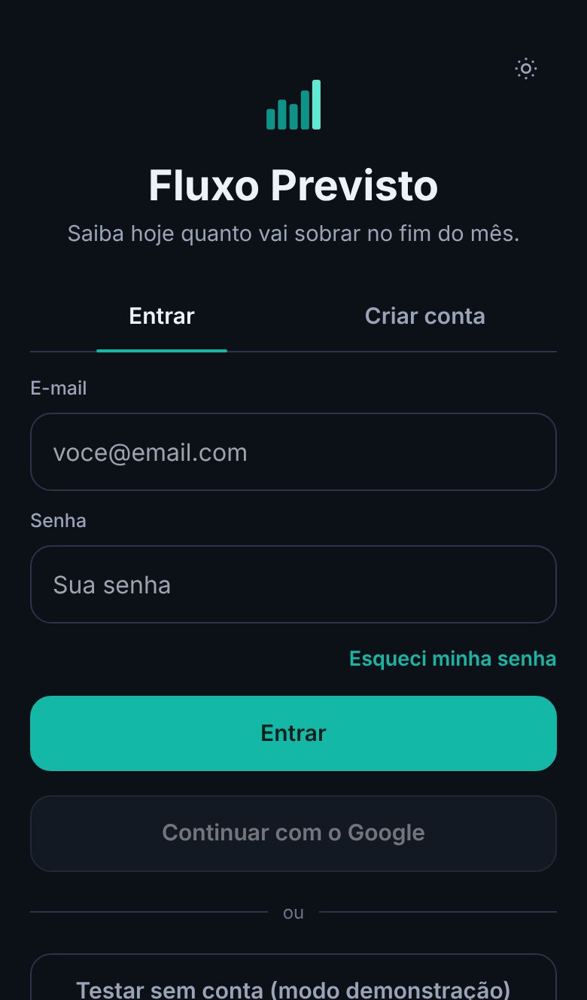

# Manual de uso

O Fluxo Previsto mostra quanto você tem hoje e quanto vai sobrar no fim de cada mês. Você informa o saldo real uma vez, cadastra contas e cartões, lança o que entra e sai (ou importa do banco) e o app projeta o resto.

## 1. Onde abrir

- **Endereço:** [jullross.github.io/fluxo-previsto](https://jullross.github.io/fluxo-previsto/). Funciona no celular e no computador.
- **Instalar no celular:** abra o endereço e use "Adicionar à Tela de Início" (iPhone, no Safari) ou "Instalar app" (Android, no Chrome).
- **Atualizar:** quando sai uma versão nova, feche o app e abra de novo. No computador, Ctrl+Shift+R.
- **Testar sem conta:** o botão "Testar sem conta" abre o app com dados de exemplo. Nada é salvo na nuvem.

Os dados ficam na sua conta (Supabase) e aparecem em qualquer aparelho em que você entrar.

## 2. Primeiros passos

1. **Entre** com e-mail e senha ou com o Google.
2. **Saldo de hoje:** em Ajustes, preencha "Quanto você tem hoje, somando as contas". Some tudo: conta corrente, conta digital, vale-refeição.
3. **Bancos e cartões:** cadastre cada conta e cada cartão. No cartão, informe o dia de **fechamento** e o de **vencimento**.
4. **Vale-refeição e benefícios:** cadastre como conta e lance o crédito mensal como entrada recorrente. Assim o dinheiro do vale entra junto com os gastos feitos nele.
5. **Lançamentos fixos:** salário, bolsa, contas da casa, assinaturas, com a regra do dia (5º dia útil, dia fixo, adiar ou antecipar em feriado).
6. **Parcelas e dívidas:** compras parceladas e dívidas antigas.

## 3. Como o saldo é calculado

| Número | O que significa |
| --- | --- |
| Quanto eu tenho hoje | Saldo real informado + o que já caiu − o que já saiu (só o que está marcado como pago ou recebido) |
| Quanto terei no fim do mês | Saldo de hoje + o que ainda vai cair − o que ainda vai sair |
| Teto de gasto diário | Quanto dá para gastar por dia sem nenhum dia ficar no vermelho até o próximo recebimento |

- **O saldo de hoje fica preso ao valor que você informou.** Lançamentos de meses anteriores não mudam esse número.
- **Lançamentos importados de meses passados** ficam só como registro ("histórico · não altera o saldo"): aparecem na lista e na divisão por categoria, mas não mexem em saldo de dia nem de mês.
- **Conferir com os bancos** (Bancos → "Conferir saldo com os bancos", ou Mais → Conferir saldo): digite o saldo que aparece agora em cada conta (vale-refeição também). O app mostra a soma, o que ele diz hoje e a diferença; "Ajustar o app" deixa os dois iguais sem mudar o histórico.
- **Saldos que se preenchem sozinhos:** contas do Open Finance trazem o saldo a cada sincronização, e o saldo de um extrato ou print importado fica guardado na conta.
- **Aviso automático:** quando todas as contas têm saldo dos últimos 3 dias e a soma não bate com o app, o sino avisa "O app está R$ X abaixo/acima dos seus bancos". Antes de ajustar, procure um lançamento que faltou ou um pago/pendente trocado.

## 4. Telas

### No celular

| Tela | Para que serve |
| --- | --- |
| Início | Saldo de hoje em destaque, sobra no fim do mês, quanto dá para gastar por dia, o que já saiu e o que ainda vai sair, ritmo da semana e próximos vencimentos |
| Lançamentos | Entradas, saídas e transferências do mês, com o filtro Todos, Conta/Pix/Débito ou Faturas de Cartão |
| Gastei | "E se eu gastar hoje?": digite o valor, escolha À vista/Pix ou No cartão (qual cartão e em quantas vezes), veja o impacto no saldo de hoje, no fim do mês, no termômetro e em cada fatura do cartão, e confirme |
| Calendário | Saldo de cada dia; dois toques num dia lançam nele |
| Mais | Dívidas, Desafio do mês, Bancos, Importar, Exportar, Ajustes e conta |

Deslize para os lados (um movimento bem horizontal) para trocar de tela; rolar para cima e para baixo nunca troca de tela. A faixa de meses no topo troca o mês em todas e começa no mês de partida.

### No computador

Abas de Lançamentos, Calendário, Dívidas e Desafio no topo. Abaixo, o painel do dia, o Termômetro e Simulador, e a análise do mês com a divisão da renda e o gráfico do ano. Ajustes fica no ícone de controles do topo.

## 5. Lançamentos

- **Tipos:** Entrada, Saída ou Transferência; Único, Recorrente ou Parcelado.
- **Pendente ou pago:** o círculo na lista marca pago. O que está pendente continua descontando da sobra, mas aparece separado em "Ainda vai sair".
- **Edição rápida:** toque no nome ou no valor para mudar na hora.
- **Transformar em recorrente:** abra um lançamento que já existe (um Pix, uma assinatura no cartão) e troque Único por Recorrente. Ele passa a aparecer todo mês a partir daquele mês. No cartão, cai sempre no vencimento da fatura.
- **Dia ou valor que variam:** quando o lançamento do mês chega do banco com o mesmo nome, o app reconhece o recorrente mesmo com até 15 dias e 15% de diferença, marca como pago e passa a prever o valor novo.
- **Transferência entre contas suas:** escolha Transferência, a conta de onde saiu e a de onde entrou. Não conta como entrada, saída nem no teto. Se aparecer "Parece uma transferência entre suas contas", toque em Juntar.
- **Gasto de outra pessoa no seu cartão:** em "Quem usou?", escolha a pessoa. O app cria o reembolso previsto e os dois se anulam no saldo.

## 6. Cartão de crédito e faturas

- **Cada compra pertence à fatura em que o banco cobra.** Compra feita depois do fechamento vai para a fatura seguinte. Ela desconta do saldo no vencimento da fatura, nunca no dia da compra.
- **Compra no cartão entra pendente.** Só vira paga quando a fatura recebe baixa.
- **Parceladas:** a parcela atual cai na fatura do mês e as próximas ficam projetadas nos meses seguintes. Quando a parcela seguinte chega do banco, ela se junta à projetada, sem duplicar.
- **Ver as faturas:** Lançamentos → Faturas de Cartão mostra cada fatura com saldo anterior em aberto, compras à vista, parcelas, assinaturas e total.
- **Dar baixa / Pagar fatura:** valor total, parcial ou "não paguei". O que faltar vai para a fatura do mês seguinte como saldo anterior em aberto, com os juros do rotativo se você informar a taxa.
- **Pagar a fatura é uma saída só:** as compras de dentro dela não somam de novo.
- **Corrigir ou excluir uma compra da fatura:** em Faturas de Cartão, toque em "Ver os lançamentos desta fatura". O **×** exclui (no parcelado, a compra inteira; no recorrente, só daquele mês em diante ou de todos) e tocar no nome abre a edição.
- **"Comprei hoje":** ao lançar uma compra no cartão, esse botão coloca a compra na fatura certa.

## 7. Importar extrato, fatura ou prints

1. Bancos → **Importar** (no celular, Mais → Importar).
2. Escolha a conta ou o cartão e o arquivo: CSV, OFX, PDF ou prints da tela do banco em JPG ou PNG (até 8 de uma vez). PDF e prints são lidos por IA.
3. **Revise:**
   - O card em destaque mostra **Saídas no arquivo** (só débitos) ou o **Total da fatura** no cartão, com a contagem de lançamentos e parcelados.
   - Linhas de saldo ("Saldo anterior", "Saldo disponível", "Saldo do dia") nunca contam como gasto.
   - Se o arquivo mostrar o saldo da conta, aparece "Usar como o meu saldo de hoje". Marque se quiser ajustar o saldo, somando o que tiver nas outras contas.
   - Desmarque o que não é seu, troque o bloco, escolha quem usou o cartão e decida o que fazer com o que "parece já lançado". "Gastos selecionados" atualiza na hora.
4. **Importe.** O que já estava previsto vira pago, sem duplicar. O "Pagamento recebido" da fatura e o pagamento de fatura no extrato da conta dão baixa na fatura. Um Pix entre contas suas vira transferência.

## 8. Open Finance

Mais → Open Finance (só para a dona do app) sincroniza as contas e os cartões conectados no Meu Pluggy. A revisão é a mesma da importação: as compras de cartão vão para a fatura certa, entram pendentes e as parcelas são projetadas e conciliadas nos meses seguintes.

## 9. Assistente

O ícone ✦ no topo (no celular, também em Mais → Assistente) abre um chat. Pergunte em texto livre ("em quantas vezes parcelo R$ 1.900?", "em que mês fico mais apertada?") e ele responde com as contas feitas com os números do app: saldo de hoje, próximos meses, faturas, fixos e parcelados. Ele só sabe o que está lançado; gastos que variam e não foram lançados entram como estimativa. Funciona só na conta da dona do app e usa a mesma chave do Gemini da leitura de PDF.

**Lançar pelo chat:** peça "lança 45 de mercado ontem no Swile", "recebi 300 no PicPay hoje" ou cole a lista de um extrato. O assistente separa os lançamentos e mostra "Revisar e lançar": abre a mesma revisão da importação, onde você confere conta, data e categoria, e o que já estava lançado não duplica. Compra parcelada no cartão: diga o total e as vezes ("tênis 300 em 3x no Bradesco"). Recorrentes também: "aluguel de 900 todo dia 5 no Nubank", "salário de 2200 no último dia útil". O assistente mostra o dia e desde quando, avisa se já existe um parecido e cria ao tocar em "Criar recorrente".

## 10. Quando algo não bate

| Situação | O que fazer |
| --- | --- |
| "Quanto eu tenho hoje" diferente do banco | Abra "Conferir saldo com os bancos", digite o saldo de cada conta e veja a diferença; procure o lançamento que faltou ou toque em "Ajustar o app" |
| Gastos do vale aparecem, mas o dinheiro do vale não | Cadastre o vale como conta e lance o crédito mensal como entrada recorrente |
| Compra do cartão no mês errado | Confira o fechamento e o vencimento do cartão em Bancos e cartões |
| O app não mostra uma função nova | Feche e abra o app. Confira se está no endereço jullross.github.io/fluxo-previsto, não num ícone antigo |
| Leitura de PDF ou print falhou | Tente de novo em alguns minutos (limite gratuito da IA) ou use o CSV/OFX do banco |

## 11. Dicas

- O ícone de olho esconde todos os valores.
- O sino lista faturas fechadas e extratos atrasados.
- O Desafio do mês só tira dinheiro do saldo depois que você aceita a meta. Aplicações e aportes lançados no mês (como "Aplicação RDB") contam como depósito do desafio: o Cofre do Desafio diminui na mesma medida.
- Exportar gera relatório em CSV ou PDF do mês ou dos próximos 12 meses.
