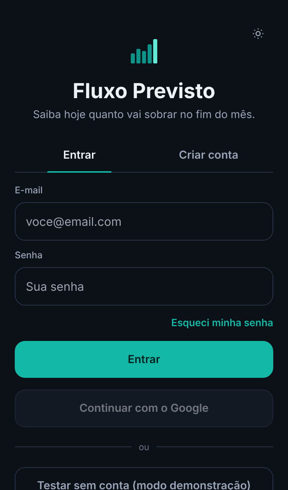

# Manual de uso

Comece por Ajustes: mês de partida e saldo inicial. Depois cadastre bancos e cartões e lance o que entra e sai todo mês; o app projeta o resto sozinho.

## Primeiros passos

1. Entre com e-mail, Google ou "Testar sem conta".
2. **Ajustes:** mês de partida, saldo inicial, metas dos blocos, cor e tema.
3. **Bancos e cartões:** conta corrente ou cartão, fechamento e vencimento, titular.
4. **Lançamentos fixos:** salário, bolsa, contas, assinaturas, com a regra do dia.
5. **Parcelas e dívidas:** compras parceladas e dívidas antigas.

## No celular

| Tela | Para que serve |
| --- | --- |
| Início | Quanto sobra no fim do mês, saldo de hoje, quanto dá para gastar por dia, ritmo da semana e próximos vencimentos (tocar marca como pago) |
| Lançamentos | Entradas e saídas do mês; o círculo marca pago, o nome ou o valor editam na hora |
| Gastei | "E se eu gastar hoje?": digite o valor, veja o impacto e confirme |
| Calendário | Saldo de cada dia; dois toques num dia lançam nele |
| Mais | Dívidas, Desafio do mês e ferramentas |

Deslize para os lados para trocar de tela; a faixa de meses no topo troca o mês em todas.

## No computador

Abas de Lançamentos, Calendário, Dívidas e Desafio no topo; abaixo, o painel do dia, o Termômetro e Simulador e a Consulta detalhada com a divisão da renda e o gráfico do ano.

## Importar uma fatura ou extrato

1. Bancos → Importar.
2. Escolha a conta ou o cartão e o arquivo (CSV, OFX ou PDF).
3. Revise: desmarque o que não é seu, troque o bloco, escolha quem usou o cartão e decida o que fazer com o que "parece já lançado".
4. Importe. O que já estava previsto é marcado como pago, sem duplicar.

## Dicas

- O ícone de olho esconde todos os valores.
- O sino lista faturas fechadas e extratos atrasados.
- Gasto de outra pessoa no seu cartão gera um reembolso previsto; os dois se anulam no saldo.
- O desafio só tira dinheiro do saldo depois que você crava a meta.
